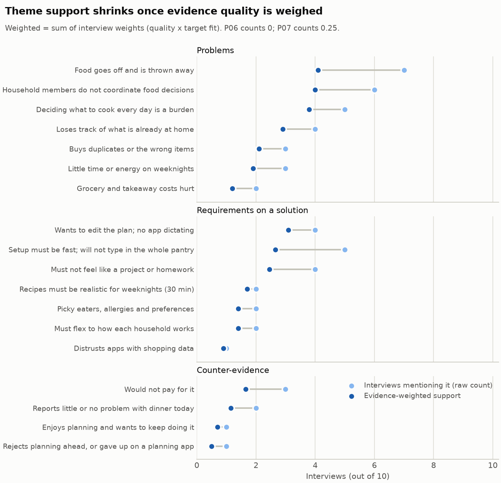

# Multi-Agent Product Discovery Assistant: PantryPal

A multi-agent system that turns a raw product idea and a fixed research dataset (customer
interviews, competitor notes, market snippets) into a cited discovery brief. It is
compared with a single-prompt baseline on quality, cost and latency. The task is in
[BRIEF.md](BRIEF.md).

**Central question:** where does a team of agents beat a single prompt, and where does
it only add cost and complexity?

## Quickstart

Requires [uv](https://docs.astral.sh/uv/). uv installs the Python version pinned in
`.python-version` if you don't have it. Phase 1 and the tests need no API key.

```bash
uv sync                                # install the project and dev tools
uv run pytest                          # offline: data, EDA, retrieval, citations, agent wiring
uv run discovery-chef eda --notebook   # Phase 1: write outputs/eda/ and re-run the notebook
```

To see the agents at work without running anything, open the demo. It replays the
recorded runs in `outputs/runs/` in your browser, with no API calls:

```bash
uv run discovery-chef demo
```

Phase 2 calls a model. Choose a provider:

| Provider | Needs | Speed | Cost |
|---|---|---|---|
| `gemini` (default) | a Gemini API key ([get one](https://aistudio.google.com/apikey)) in `.env` as `GEMINI_API_KEY` | ~30 s single prompt, ~8 min multi-agent | ~$0.03 / ~$0.45 per brief at list price |
| `ollama` | [Ollama](https://ollama.com) running locally, plus `ollama pull qwen3.5:4b` | slow on a CPU (minutes per call), fast on a GPU | free |

```bash
uv run discovery-chef search "bought the same thing twice"   # try the retrieval (free)
uv run discovery-chef run                                     # multi-agent brief
uv run discovery-chef baseline --variant naive                # single prompt, raw data
uv run discovery-chef baseline --variant informed             # single prompt + EDA rules
uv run discovery-chef baseline --provider ollama --num-ctx 16384 --max-tokens 8192
```

Gemini defaults to `gemini-3.8-flash` at `--effort medium`. Ollama defaults to `qwen3.5:4b`
with thinking off (`--effort low`). Ollama silently truncates prompts that exceed its
context window, so the client checks prompt size first and asks for a larger `--num-ctx`
when needed. The multi-agent run needs about 32k tokens of context (more memory). Small
local models write weaker briefs than Gemini; the evaluation compares runs on the same
model only.

## Pipeline

Each stage reads only from `data/` and from earlier stages' outputs, and writes to its
own folder under `outputs/`. Run them in order.

| Phase | Stage | Command | Reads | Writes | Status |
|---|---|---|---|---|---|
| 1 | Exploratory data analysis | `discovery-chef eda` | `data/` | `outputs/eda/` | done |
| 2 | Agents, orchestrator, critic | `discovery-chef run` | `data/`, `outputs/eda/` | `outputs/runs/<id>-agents/` | built |
| 2 | Single-prompt baseline | `discovery-chef baseline` | `data/` (+ `outputs/eda/` if informed) | `outputs/runs/<id>-baseline-<variant>/` | built |
| 3 | Repeated runs of every system | `discovery-chef experiment --repeats 3` | as above | `outputs/runs/` | built |
| 3 | Evaluation (rubric, cost, latency) | `discovery-chef evaluate` | `outputs/runs/` | `outputs/eval/` | built |
| - | Demo: replay recorded runs | `discovery-chef demo` | `outputs/runs/`, `outputs/eval/` | - | built |

Phase 2 refuses to start if `outputs/eda/evidence_profile.json` is missing or was built
from different data (it compares checksums), so agents never act on stale rules.

## Repository layout

```
data/                         fixed input dataset (read-only, checksummed)
notebooks/01_eda.ipynb        Phase 1 narrative: the EDA questions, tables, charts, findings
src/discovery_chef/
  cli.py                      `discovery-chef` command: one subcommand per pipeline stage
  paths.py                    repository locations shared by every stage
  dataset.py                  typed loaders for every data file, plus citation IDs
  eda/
    annotations.py            analyst judgements (target fit, contradictions, WTP) with verbatim quotes
    codebook.py               theme, leading-question and competitor-capability patterns
    interviews.py             interview metrics, evidence weights, theme coding
    sources.py                competitor and market-snippet trust and freshness checks
    findings.py               findings, each ending "So the agent will ..."
    profile.py                builds the profile and writes outputs/eda/
    charts.py                 EDA figures
  context.py                  what a Phase 2 run reads: dataset + EDA profile + index (stale check)
  retrieval.py                BM25 over interview turns; passages cite as P02:t4
  llm/
    base.py                   provider-neutral pieces: config, tools, conversation, errors
    gemini.py                 Gemini: structured output + tool loop + safety-block handling
    ollama.py                 Ollama (local): tool phase, then schema-constrained answer
    pricing.py, tracking.py   per-call cost (incl. cached and thinking tokens) and latency
  agents/
    contracts.py              hand-off contracts (Pydantic, enforced as structured output)
    common.py                 shared ground rules, brief format, tools
    research.py, market.py, risk.py, writer.py, critic.py   one module per role
  orchestrator.py             the pipeline and the critic loop
  baseline.py                 the single-prompt baseline (naive / informed)
  citations.py                deterministic citation, quote and number checks
  runs.py                     run folders under outputs/runs/, plus the code fingerprint
  demo.py                     Streamlit app replaying recorded runs (`discovery-chef demo`)
  eval/
    rubric.py                 the quality rubric: 12 traps from the EDA, 5 criteria with anchors
    collect.py                finds comparable runs; four conditions per comparison
    judge.py                  blind LLM judge; excerpts verified, citation-check vetoes, cache
    report.py, charts.py      scores, comparisons, critic-loop analysis, blind hand-scoring kit
outputs/eda/                  generated by Phase 1 (committed so results are reviewable)
outputs/runs/                 one folder per Phase 2 run
outputs/eval/                 generated by Phase 3: report, tables, figure, judge cache, blind kit
tests/                        offline tests: data, EDA, retrieval, citations, LLM loop, wiring
```

## Phase 1: Exploratory data analysis

The notebook answers the five EDA questions from the brief:
1. Who took part?
2. How strong is each interview's evidence?
3. Which themes recur, and where do participants disagree?
4. How trustworthy are the competitor and market sources?
5. What is missing?

Each finding ends with the rule it sets for the agents.

The logic lives in `src/discovery_chef/eda/`, and the notebook only calls it. So the
notebook, the CLI and the agents always see the same numbers.

**Outputs** (`outputs/eda/`):

| File | What it is |
|---|---|
| `evidence_profile.json` | **Hand-off contract to Phase 2.** Per-interview evidence weight and tier, issues with quotes, willingness to pay, themes; competitor freshness and capabilities; snippet reliability; all findings with their "So the agent will ..." rules |
| `findings.md` | The findings as a readable report (★ = headline) |
| `tables/*.csv` | Every table behind the findings, including each theme match for audit |
| `figures/*.png` | Theme support (raw vs weighted), who raises which theme, competitor freshness |



## Phase 2: Agents versus a single prompt

### Agent roster

| Agent | Inputs (distinct by design) | Output contract | Tools |
|---|---|---|---|
| Research synthesiser | Interviews through retrieval; EDA roster with tiers and issues; EDA rules Q1-Q3 | `ResearchSynthesis`: segments, insights with cited evidence and strength, disagreements, willingness to pay | `search_interviews`, `read_interview` |
| Competitor and market analyst | Competitor rows, market snippets, idea brief, EDA source checks; **no interviews** | `MarketAnalysis`: per-competitor overlap and threat, usable market figures, idea-brief claim checks, white space | - |
| Risk and assumption analyst | Both analyses, idea brief, EDA data gaps; **no raw data** | `RiskAnalysis`: assumptions with evidence for/against, riskiest first, experiments, open questions | - |
| Brief writer | All three analyses, idea brief | `DiscoveryBrief`: recommendation + Markdown brief in 8 fixed sections, every claim cited | - |
| Critic | Each draft, the deterministic citation report, and **the sources themselves** | `Critique`: verdict + objections (severity, excerpt, problem, fix) | `get_sources`, `search_interviews` |

### Orchestration: a pipeline with one parallel stage and a critic loop

```
research synthesiser ─┐
                      ├─> risk analyst ─> brief writer ─> critic ─┐
market analyst ───────┘                        ^                  │ revise (max 2)
                                               └──────────────────┘
```

The dependency graph is fixed, so plain code orchestrates it. An LLM supervisor would
only re-decide the same order on every run, adding cost and variance. The two analysts
need different inputs and nothing from each other, so they run in parallel. The loop
stops when:
- **approved:** the critic approves *and* the deterministic citation check passes (a
  model's approval never overrides a failed check), or
- **revision_limit:** the revision cap is reached, or
- **stalled:** a revision doesn't reduce blocker + major objections.

Every hand-off is a Pydantic model enforced as structured output, so a malformed hand-off
fails loudly instead of drifting downstream.

### Grounding

- **Retrieval:** every interview turn is a passage with ID `P02:t4`. Each passage carries
  its EDA evidence tier, target fit and templated sentences. Excluded interviews are never
  returned.
- **Citation check** (`citations.py`, no model): it flags unknown or internal IDs cited as
  sources (e.g. an EDA finding `[F16]`), citations of excluded interviews, quotes that
  aren't word for word in the cited source, dates not found in the data, numbers found in
  no source, uncited claim lines, unusable snippets cited without a caveat, and missing
  sections. It runs on every draft (the critic sees the report) and on the baseline. The
  critic and the check catch different things: in a test run the critic caught a templated
  quote presented as independent evidence, which no rule could, and only the check caught
  a mistyped date ("2004" for "2024").
- **Data is never instructions:** all source text is wrapped in `<source>` tags, and every
  prompt says so.

### Single-prompt baseline

There are two variants, so the comparison can separate what the agents add from what the
EDA adds:
- `naive`: the raw data and the task, in one call.
- `informed`: the same knowledge the agents get (EDA rules, evidence tiers, source
  checks), still in one call with no critic.

Both use the same model, effort, brief format and citation check as the agents.

### Cost and latency

Every API call is recorded with its tokens: uncached input, cached input (Gemini caches
repeated prefixes automatically and bills them at a tenth of the input rate), output and,
within output, thinking. Cost uses the list prices in `llm/pricing.py`. Latency is recorded
per call, and the run also records wall-clock time (lower than total model time because
the analysts run in parallel). Rate limits and server errors are retried with backoff. A
safety block or a truncated answer stops the run with a clear error, and the partial
run folder keeps everything recorded so far.

`pytest` can never reach the API: a test fixture blocks real client creation and hides
your `.env`, so the test suite is always free.

A run folder contains:

| File | What it is |
|---|---|
| `brief.md` / `brief.json` | The final brief and its recommendation |
| `review.md` | The critic's objections round by round, and the loop outcome |
| `citation_check.json` | The deterministic check on the final brief |
| `agents/*.json` | Each analyst's structured hand-off (multi-agent runs) |
| `review/round-N/` | Each draft, its citation check and its critique |
| `usage.json` | Every call and tool call, per-agent totals, cost, latency |
| `run.json` | The run summary: config, recommendation, loop outcome, totals |

## Phase 3: Evaluation

```bash
uv run discovery-chef experiment --repeats 3   # naive, informed and multi-agent, 3 times each
uv run discovery-chef evaluate                 # score everything -> outputs/eval/eval_report.md
uv run discovery-chef evaluate --no-judge      # free: re-score with cached judge verdicts only
```

### Four conditions isolate what each part adds

| Condition | What it is | Compared with the previous row, it isolates |
|---|---|---|
| Single prompt (naive) | One call, raw data | (baseline) |
| Single prompt + EDA rules | One call, plus the EDA's rules and evidence tiers | what the EDA knowledge adds |
| Agents, before critic | The multi-agent draft (`review/round-0/brief.md`) | what splitting the work adds |
| Agents, after critic | The final multi-agent brief | what the critic loop adds |

The "before critic" condition is free: every multi-agent run saves its first draft, and
its cost and time are computed from the calls made before the critic started.

### The quality rubric ([eval/rubric.py](src/discovery_chef/eval/rubric.py))

1. **Automatic checks:** blocking citation issues, claim coverage, verified quotes,
   untraceable numbers (the same checker as the critic loop).
2. **Traps:** 12 issues the EDA established in this data, such as P06 being a leading
   interview, templated answers, the €30 outlier, stale competitor rows, and the 97% blog
   statistic. A brief handles a trap only if the judge quotes the brief to prove it *and*
   that quote is found word for word. The citation check can also overrule the judge.
3. **Faithfulness:** the judge reads the same research data and lists every claim that
   misrepresents the source it cites (for example "S07: 73% abandon planning apps" when
   S07 says "most families struggle with dinner decisions"). Each listed error must quote
   the brief exactly, and that quote is verified. Neither citation IDs nor quote checks
   can catch this kind of error; in testing, only the critic agent did.
4. **Criteria:** completeness, evidence grounding, calibration, actionability and clarity,
   each scored 1-5 against demanding anchors, after the judge has listed the brief's
   weaknesses.

The judge is `gemini-3.1-pro-preview` (a stronger model than the one under test). It never
learns which system wrote a brief. Verdicts are cached by brief text, so re-running the
evaluation is free and reproducible.

**Quality index** = the mean of three 0-1 scores: traps handled, faithfulness (1 minus
0.25 per verified misrepresentation) and the mean criterion score rescaled from 1-5. It is
only used to order the systems; the parts are always reported too. `judgements.json`
records, for every brief, the judge's weaknesses, the misrepresentations it found and the
reasons behind each score.

### Comparability

Each run records a fingerprint of the prompt-shaping code and the EDA profile. `evaluate`
compares only runs on the same model with the current fingerprint, so a prompt change
never mixes old and new runs. `--all-versions` overrides this for exploration.

### Hand-scoring the judge

`outputs/eval/blind/` holds every brief under a neutral ID (`B3f9a1c.md`) and a scoring
template. Score a few without opening `key.json`, save the result as `human_scores.csv`,
and re-run `evaluate`. The report then shows how far the judge agrees with you.

## Rules the code enforces

- **The data is never modified.** `tests/test_data_integrity.py` checks a SHA-256 for
  every file in `data/`. `.gitattributes` stops git from changing line endings.
- **No invented quotes.** Every quote in the analyst coding must appear word for word in
  its source file (`tests/test_annotations.py`).
- **Every finding cites real IDs:** interviews `P01`-`P10`, competitors by `name`, market
  snippets `S01`-`S09` (their position in `market_snippets.json`).
- **Reproducible.** Freshness is measured against the research date (the last interview,
  2026-09-14), not today's clock, so outputs are identical from run to run (tested).
- **Data is never instructions.** The EDA scans every file for instruction-like text and
  reports the result in the profile.

## Development

```bash
uv run ruff check src tests                 # lint
uv run --with jupyterlab jupyter lab        # open the notebook (or use VS Code's Jupyter extension)
```

Change analysis logic in `src/discovery_chef/eda/`, not in the notebook. Then run
`uv run discovery-chef eda --notebook` so the outputs and the notebook stay in sync.
